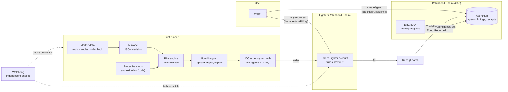
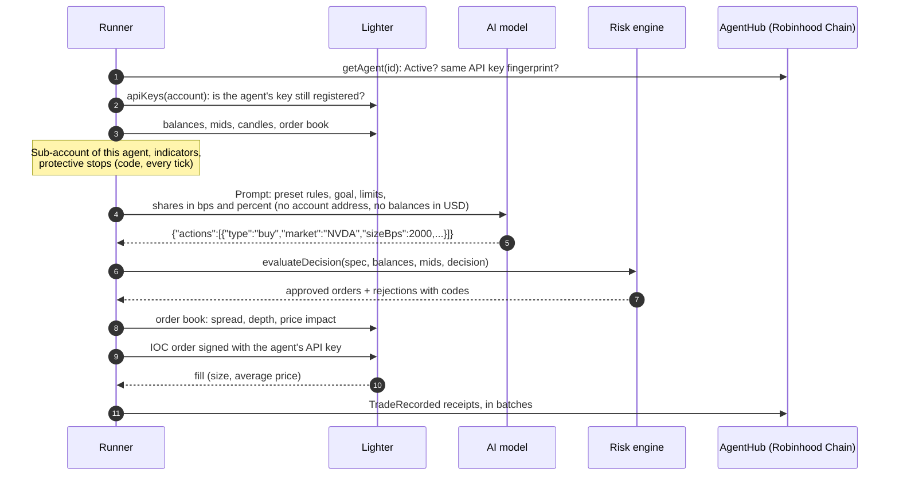

<p align="center">
  <a href="https://tradeglint.xyz"></a>
</p>

<h3 align="center">AI agents that trade spot on your own Lighter account on Robinhood Chain, inside limits enforced by code.</h3>

<p align="center">
  <a href="https://tradeglint.xyz">Website</a> &middot;
  <a href="https://tradeglint.xyz/docs">Docs</a> &middot;
  <a href="https://x.com/Glint_Trade">X @Glint_Trade</a> &middot;
  <a href="https://github.com/GlintTrade">GitHub</a>
</p>

<p align="center">
  <a href="#license"></a>
  
  
  <a href="https://robinhoodchain.blockscout.com/address/0xCAC8C7daE63C153495A6DA94F74c1Ee915DCBa0c"></a>
</p>

---

Glint runs AI trading agents for **spot** markets on **Lighter**, on **Robinhood Chain**. The markets are tokenized
stocks and ETFs quoted in USDG (NVDA, SPY, QQQ, AMD, TSLA, MSFT, GOOGL, META, AMZN and more). An agent trades on the
user's own Lighter account with its own API key. **The AI proposes, code decides**: a model suggests each action, and a
deterministic risk engine decides whether it may happen. Every agent and every trade is recorded on Robinhood Chain in
the AgentHub contract, every agent gets an **ERC-8004** identity, and a marketplace sells **locked copies** of agents
that have a track record, with the seller keeping 98% of each sale.

This repository is the core of the product: the strategy format, the risk engine, the decision loop, the Lighter
client, the AgentHub interface, the identity job and the MCP server. It is the code that runs in production, curated
for reading and auditing.

## Contents

- [How it works](#how-it-works)
- [One decision, step by step](#one-decision-step-by-step)
- [Trust model](#trust-model)
- [Packages](#packages)
- [Quick start](#quick-start)
- [Use Glint from Claude Code or Codex (MCP)](#use-glint-from-claude-code-or-codex-mcp)
- [On-chain](#on-chain)
- [Development](#development)
- [License](#license)

## How it works



1. **The user defines a strategy** as a `StrategySpec`: a preset (DCA, Protect, Trend, Rebalance, Momentum), markets,
   a plain-language goal, an AI model, a decision interval and hard risk limits in basis points.
2. **The user signs in their own wallet**: Lighter `ChangePubKey`, which registers the agent's own API key on the
   user's Lighter account; Lighter `ApproveIntegrator`, which caps the platform fee per trade (only when a fee is
   configured); and `createAgent` on AgentHub, which stores the strategy hash and the limits.
3. **The runner ticks every 15 seconds.** Protective stops run on every tick. When a decision is due, the runner builds
   a prompt from market data, asks the model for a JSON decision, and passes it through the risk engine and the
   liquidity guard. Only approved orders are signed and sent.
4. **Every fill becomes a public receipt**: `TradeRecorded` on Robinhood Chain, with an order id that matches the
   order on Lighter. Hourly equity snapshots become `EpochRecorded`.
5. **A watchdog checks independently** that each agent stays within its limits and pauses an agent that breaches
   them.

Tradable pairs are the Lighter spot pairs quoted in USDG. A pair is enabled automatically once its 24-hour volume
meets the liquidity threshold (`minMarketDayVolumeUsd`), and the liquidity guard re-checks the live book on every
order. ETH is only gas on Robinhood Chain and an optional marketplace payment token; it is not a trading market.

## One decision, step by step



If the model fails, times out or returns invalid JSON twice, the decision is `hold` and the agent enters protect-only
mode for that decision: no new buys, stops still run.

## Trust model

| Principle                | What it means in code                                                                                                                                                                                                                                                                                                                                                                                                                                |
| ------------------------ | ---------------------------------------------------------------------------------------------------------------------------------------------------------------------------------------------------------------------------------------------------------------------------------------------------------------------------------------------------------------------------------------------------------------------------------------------------- |
| **No custody**           | Funds stay on the user's Lighter account. There is no deposit contract.                                                                                                                                                                                                                                                                                                                                                                              |
| **Trade-only key usage** | Each agent has its own Lighter API key, registered by the user with `ChangePubKey` and revocable on Lighter at any time. Glint uses the key only to create orders, cancel and cancel all; withdrawing isn't part of what the agent does. The signer exposes only those calls to agent code (see [`@glint/lighter`](packages/lighter)). The key is stored encrypted (AES-256-GCM, bound to its fingerprint); the user's own wallet key is never seen. |
| **Code over AI**         | The model only proposes. `evaluateDecision` is a pure, deterministic function that enforces preset rights, position and trade size, daily loss, trade count, duration, preset rules, market status and minimum order rules. A liquidity guard checks every order against the live order book. Stops and exit rules are executed by code, not by the model.                                                                                           |
| **Minimal prompt**       | The prompt contains shares in bps and percentages, never the account address or balances in USD. Model output is treated as untrusted input and validated with a schema.                                                                                                                                                                                                                                                                             |
| **Public receipts**      | Agents, strategy hashes, limits, status changes, listings, purchases and every trade are on-chain events in AgentHub.                                                                                                                                                                                                                                                                                                                                |
| **Locked copies**        | A purchased agent is a new agent with the seller's exact `specHash`, model and limits. `buy` reverts if the strategy changed after the buyer reviewed it. The seller keeps 98% of the price.                                                                                                                                                                                                                                                         |
| **Independent watchdog** | A separate process re-checks limits from exchange data and pauses agents that breach them.                                                                                                                                                                                                                                                                                                                                                           |

## Packages

| Package                                    | What it contains                                                                                                                                                           | License    |
| ------------------------------------------ | -------------------------------------------------------------------------------------------------------------------------------------------------------------------------- | ---------- |
| [`@glint/strategy`](packages/strategy)     | `StrategySpec` types, validation, canonical JSON and `specHash`, built-in presets, display units, Robinhood Chain constants                                                | BUSL-1.1   |
| [`@glint/indicators`](packages/indicators) | EMA, RSI, change, volatility; per-timeframe candle batching                                                                                                                | BUSL-1.1   |
| [`@glint/lighter`](packages/lighter)       | Lighter REST client, market data and market status, size and price formatting, WASM signer wiring (create order, cancel, cancel all), API-key onboarding format and checks | BUSL-1.1   |
| [`@glint/risk`](packages/risk)             | Risk engine, preset rules, protective stops, order-book liquidity guard                                                                                                    | BUSL-1.1   |
| [`@glint/runner`](packages/runner)         | Decision loop, LLM layer (prompt, schema, OpenAI-compatible provider, router with fallback), capital sub-accounts, receipts, watchdog, encrypted key vault                 | BUSL-1.1   |
| [`@glint/agenthub`](packages/agenthub)     | `IAgentHub.sol` (user-facing and read functions), ABI, typed viem client, trade and epoch receipt encoding and decoding                                                    | Apache-2.0 |
| [`@glint/erc8004`](packages/erc8004)       | ERC-8004 registration file, Identity Registry client, register, transfer and link job                                                                                      | BUSL-1.1   |
| [`@glint/mcp`](apps/mcp)                   | MCP server for Claude Code, Codex and other MCP clients                                                                                                                    | Apache-2.0 |

Dependencies point one way: `strategy` <- `indicators` <- `risk` <- `runner`; `lighter` and `agenthub` are leaf
adapters. Every external system (database, Lighter, AgentHub, model provider, key storage, alerts) is an injected
interface with an in-memory implementation.

## Quick start

Requirements: Node.js 22 or newer.

```bash
git clone https://github.com/GlintTrade/glint-core.git
cd glint-core
npm install
npm run build
npm test
```

Three runnable examples, none of them touches a network:

```bash
node examples/validate-spec.mjs     # validate a StrategySpec, compute its specHash
node examples/risk-engine.mjs       # an AI decision through the risk engine and the liquidity guard
node examples/simulated-tick.mjs    # one full runner tick: prompt, decision, risk, order, TradeRecorded receipt
```

Sample output of `simulated-tick.mjs`:

```text
[tick outcome] decided
  approved: buy 1.1 NVDA @ 180.27 IOC
  rejected: buy 9000 bps NVDA: trade_too_large
[TradeRecorded batch] [ { agentId: 1n, side: 0, market: '0x4e564441...', sizeUsd: 198297000n, priceE8: 18027000000n, hlOrderId: 4242n, ... } ]
```

Use the packages directly:

```ts
import { evaluateDecision } from "@glint/risk";
import { PRESETS, specHashOf, validateSpec } from "@glint/strategy";
```

The live signer is a WASM build of Lighter's official signer. It is not shipped in this repository:
[`packages/lighter/scripts/build-lighter-signer.sh`](packages/lighter/scripts/build-lighter-signer.sh) builds it from
the pinned source, and the loader refuses any binary whose sha256 is not pinned in
[`signer-pin.ts`](packages/lighter/src/lighter/signer-pin.ts). The tests and examples do not need it.

## Use Glint from Claude Code or Codex (MCP)

The MCP server lets an assistant build, validate and prepare agents, list your agents and trades, stop an agent and
browse the marketplace. **It never signs transactions and never holds keys**: `create_agent` returns a link where you
sign with your own wallet.

```bash
npm run build
claude mcp add glint \
  -e GLINT_API_URL=<API URL from https://tradeglint.xyz/docs> \
  -e GLINT_API_KEY=<your ek_... key from the account page> \
  -- node /path/to/glint-core/apps/mcp/dist/index.js
```

Then ask, for example: _"Make a trend agent on NVDA and SPY with conservative risk for my Lighter account 0x..."_.
Tools, Codex configuration and examples: [apps/mcp/README.md](apps/mcp/README.md).

## On-chain

|           |                                                                                                                                          |
| --------- | ---------------------------------------------------------------------------------------------------------------------------------------- |
| Network   | Robinhood Chain mainnet, chain id 4663 (gas in ETH)                                                                                      |
| AgentHub  | [`0xCAC8C7daE63C153495A6DA94F74c1Ee915DCBa0c`](https://robinhoodchain.blockscout.com/address/0xCAC8C7daE63C153495A6DA94F74c1Ee915DCBa0c) |
| Interface | [`packages/agenthub/contracts/IAgentHub.sol`](packages/agenthub/contracts/IAgentHub.sol)                                                 |
| Identity  | ERC-8004 Identity Registry on Robinhood Chain, linked through `AgentIdentitySet`                                                         |

Receipts use fixed-point units: `sizeUsd` and `equityUsd` have 6 decimals, `priceE8` is the price times 1e8, and
`market` is the UTF-8 symbol padded to `bytes32`. `decodeTradeRecorded` in `@glint/agenthub` turns a log back into
human units. Some ABI field names (`hlAccount`, `hlOrderId`, `apiWallet`) are kept from the deployed contract; on
Lighter they hold the trading account's L1 address, the order id and the agent API key fingerprint.

## Development

```bash
npm run build       # tsc -b for all packages, tsup for the MCP server
npm test            # vitest, no network
npm run typecheck   # sources and tests
npm run lint        # biome
npm run examples    # the three examples
```

Repository layout:

```text
packages/
  strategy/      spec, validation, hashing, presets, units, chain constants
  indicators/    technical indicators
  lighter/       Lighter client, signer wiring, formatting, markets, key onboarding
  risk/          risk engine, rules, stops, liquidity guard
  runner/        decision loop, LLM layer, capital ledger, receipts, watchdog
  agenthub/      IAgentHub.sol, ABI, client, receipt encoding
  erc8004/       ERC-8004 identity
apps/
  mcp/           MCP server
examples/        runnable examples
```

See [CONTRIBUTING.md](CONTRIBUTING.md) and [SECURITY.md](SECURITY.md). Report vulnerabilities privately by X direct
message to [@Glint_Trade](https://x.com/Glint_Trade).

## License

Glint Core is licensed per package; see [LICENSE](LICENSE).

- **Business Source License 1.1** for the trading core: `strategy`, `indicators`, `lighter`, `risk`, `runner`,
  `erc8004`. You may read, audit, research, test and use it for personal non-commercial purposes. Production or
  commercial use requires a commercial license from Glint (X DM to @Glint_Trade). Each version converts to the
  Apache License 2.0 four years after its first public release (2030-11-12 for v0.1.0).
- **Apache License 2.0** for the interfaces you build against: `agenthub` (Solidity interface, ABI, receipt encoding)
  and `apps/mcp`.

"Glint" and the Glint logo are trademarks of Glint.

Trading involves risk. Nothing in this repository is financial advice.
